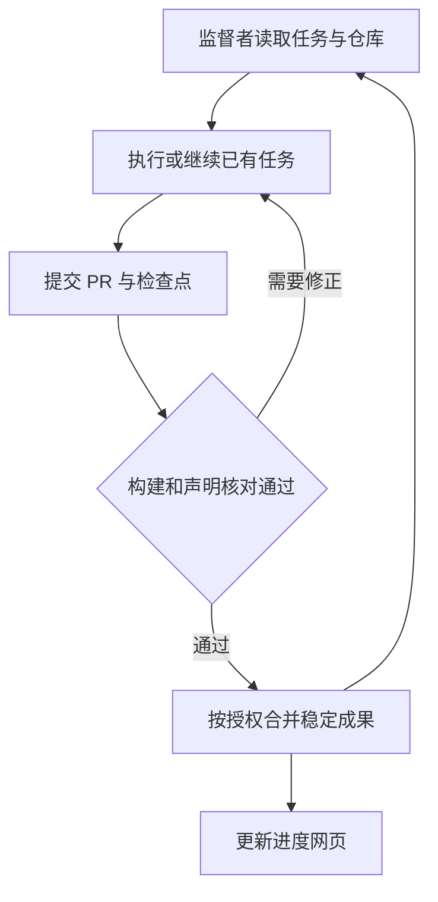

# Lean 长期形式化流程审核与修改意见

审核对象：MarkdownNote.zip 中的 Carleman_Lean_Cloud_StartKit。日期：2026 年 10 月 17 日。

**这套流程的研究路线可以保留，但启动和运行协议需要实质修改。GitHub 配置可以由具备相应连接和权限的 AI 完成，首轮应以实际构建、PR 合并和下一任务接续成功为验收；Dot 与 ChatGPT Work 应围绕同一个监督入口工作，Codex Cloud 承担默认的 Lean 证明任务；网页和项目状态应删除整套用量统计。最需要优先修复的是：缺少 Lean CI 和 PR 合并闭环、任务接力没有明确基线，以及条件性成果会被现有代码误计为完整形式化。目标是让证明工作可靠地持续推进，并减少重复报告和不必要的停工关卡。**

以下是对流程的修改意见，不是原启动包已经改好的版本。数学部分核对了与流程有关的陈述、定义和证明接口，不构成对整篇论文正确性的重新审定。文中原文件定位均相对于压缩包内的 Carleman_Lean_Cloud_StartKit。

# 一 应保留的主干

原方案有四点值得保留：

- 近期以 Theorem 2.1 为核心目标，先完成条件性 Section 5 transfer，再补 Sections 3–4，随后推进具体 PDE、离散格式和控制应用。
- 以固定版本的源码仓库记录成果，明确 Lean 声明、论文定位和可恢复的代码提交。
- 每项工作有可核验的目标，允许根据数学依赖调整证明路线。
- 条件性结果清楚列明额外前提，遇到困难时保留具体阻塞和有价值的中间成果。

README 第 5 行已经说明这是启动包，而不是已经建立的形式化工程。现阶段没有 Lean 工程本身并非错误；需要修正的是把首轮必须交付的工程能力、实际配置和接续验收写清楚。

# 二 GitHub 配置应由启动任务完成并实际验收

## 现有配置完成了什么

唯一的 GitHub workflow 是 `.github/workflows/dashboard.yml`。第 28–40 行依次执行代码检出、Python 状态生成、上传 `docs/` 和发布 GitHub Pages；它没有执行 Lean 构建。

其中的 Pages 权限、`github-pages` 环境和只上传 `docs/` 的组织基本合理。同一 job 内顺序生成和发布不需要另设 `needs`；官方文档也给出了单 job 的部署形式。因此无需把这个 YAML 全部推翻。[GitHub Pages 官方工作流文档](https://docs.github.com/en/pages/getting-started-with-github-pages/using-custom-workflows-with-github-pages)

真正缺少的是 `lean-ci.yml`，以及与其相配套的 Lean 工程、构建入口和检查结果记录。

## 谁负责配置哪些内容

| 配置 | 建议负责者 | 必须看到的结果 |
| --- | --- | --- |
| Lean 工程与版本锁定 | Codex Cloud 或具有代码执行能力的 Work | `lean-toolchain`、Lake 配置及依赖锁文件，实际构建通过 |
| Lean CI | 代码执行者 | PR 和主分支上的真实构建记录 |
| GitHub 仓库与连接 | 启动执行者通过现有连接、API、CLI 或可用网页工具完成 | 正确仓库可读写，代码已落在指定分支 |
| 主分支检查规则 | 有相应管理权限的启动执行者 | 仓库设置中真正启用所选检查 |
| 常规 PR 合并 | 唯一监督者 | 检查通过后按启动授权合并；失败时返回原 PR 修正 |
| Pages 发布源 | 选择 Pages 时由启动执行者配置 | Pages 设置与实际发布结果一致 |
| Codex Cloud 环境 | 在 Cloud 环境设置中准备并发布 | 新任务确实能使用相同 Lean 工具链与依赖 |

**写入 AGENTS.md 的规则不会自动变成 GitHub 仓库设置。**同样，给 AI 一份配置说明不能证明它拥有管理权限。启动执行者应完成可完成的部分，准确列出受限的具体操作；无需把所有设置工作预先交回给用户。

受保护分支和自动合并在私有仓库中的可用性受 GitHub 套餐限制；自动合并还要先在仓库启用，再对相应 PR 使用。ChatGPT Pro 与 GitHub Pro 是不同产品，不能混为同一个权限来源。[受保护分支](https://docs.github.com/en/repositories/configuring-branches-and-merges-in-your-repository/managing-protected-branches/about-protected-branches)；[自动合并](https://docs.github.com/en/pull-requests/how-tos/merge-and-close-pull-requests/automatically-merging-a-pull-request)

对当前账户不支持的便利功能，应采用可运行的简化流程，例如保留私有仓库和真实 CI，由监督者按结果执行已授权的普通合并。不要把购买新套餐设成开工条件。

## Cloud 环境与源码都要可复现

官方说明 Cloud 能根据仓库准备工具、依赖并测试环境，发布后供独立任务使用；新任务与原任务的工作状态并不相同，环境更新也有重新发布的步骤。[Cloud environments](https://learn.chatgpt.com/docs/environments/cloud-environments)

因此启动流程应要求：

- Lean 与 mathlib 使用明确版本，不在每次任务中追随未固定的最新版。
- 可重复的安装或启动说明放在仓库或环境配置中。
- 新任务核实实际代码分支和起始提交，不能仅凭环境名称判断源码已更新。
- 主要成果推送到仓库；环境缓存服务于运行效率，源码仓库承担长期保存。
- 环境重建、缓存丢失或依赖更新后，仍能按记录恢复工作。

这些是启动任务的交付要求，不要求用户亲自写安装脚本。

# 三 长期运行只需要一个清楚的接续闭环

## 角色分工

| 角色 | 默认职责 |
| --- | --- |
| Dot 作为唯一监督者 | 选择下一任务，接续已有任务，处理 PR，维护总状态，向用户汇报 |
| Codex Cloud | 在固定工程中写 Lean、构建、修正证明并保存检查点 |
| ChatGPT Work | 数学陈述核对、文献阅读、配置协助、网页和报告；需要时也可承担有工具支持的执行工作 |
| GitHub CI | 对确定的代码提交执行预设检查，生成结果 |
| 私人进度网页 | 展示最近同步的成果、阻塞和执行状态 |

ChatGPT Work 适合有明确交付和验收条件的长期工作；具体可用工具仍由当前环境决定。[Long-running work](https://learn.chatgpt.com/docs/long-running-work)

可以将 Work 选作监督入口，但那应当是接替同一职责，不应同时保留两个各自派发相同任务的监督者。也无需把 Work 限制成“只能建网站”：关键是共用仓库、接口和任务记录。

## 推荐的接续机制



这张图描述日常证明任务。配置任务、文献调查和明确的失败报告可以有不同交付形式，但仍应保存可接续的结果。

官方确认 Dot 能创建预先配置好的 Cloud 环境中的任务，检查并继续自己创建的任务，也能在对话间自行决定何时继续工作。[Tasks and memory](https://learn.chatgpt.com/docs/dots/tasks-and-memory)

所以“每六小时检查一次”应改成**兜底巡检**：任务完成或出现反馈时尽快接续；六小时巡检用于发现漏接、停滞或无人处理的结果。每日中文摘要只是通知节奏，不是派发下一任务的前置条件。

若保留固定周期，就实际保存调度并记录其身份、Asia/Shanghai 时区及投递位置。支持 GitHub 事件的账户可以后续使用事件触发；基础流程不必等待 webhook 建设。官方说明事件触发受计划和权限限制，事件与定时触发不能混在同一个任务中。[Scheduled tasks](https://learn.chatgpt.com/docs/automations)

## 明确 PR 合并责任

现有 `CODEX_CONTINUE.md` 第 5 行要求任务交付后停止，`DOT_SUPERVISOR.md` 第 7–10 行要求检查与验收，却没有明确谁负责合并。

建议未来启动指令写明：

> 在既定数学目标和已有授权范围内，由监督者在构建和必要声明核对通过后合并常规证明 PR；需要修正时继续原任务。合并后核实新的基线，接着安排下一项工作。

应将此作为未来启动时的持续工作约定。本次“审查修改意见”不等于已经执行或批准了具体仓库上的合并。

## 区分继续任务和新建任务

- 同一目标仍有未合并代码、CI 错误或审核修改：优先继续原 task 和原分支。
- 上一目标已经合并，或确有独立工作：新任务从明确的已合并基线开始，记录 `base_commit`。
- 一轮未完成证明：仍推送有价值的检查点，留下准确的下一目标。
- 任务记录与实际平台状态不一致：先核实再派单，避免重复启动。

## 保留一个最小任务台账

现有 `state/progress.json` 第 12–19 行只有一个任务标题、URL 和时间，不能充分支持任务接力。

可以用 GitHub Issue，也可以在现有 JSON 中增加任务数组；选一个即可，不需要新建数据库。每项任务至少记录：

| 字段 | 内容 |
| --- | --- |
| 任务身份 | 唯一编号、平台 task ID 或可定位的链接 |
| 数学目标 | 论文定位、验收条件、依赖目标 |
| 代码基线 | 分支和 `base_commit` |
| 当前状态 | 待开始、进行中、待审、已合并或阻塞 |
| 成果 | PR、检查点、Lean 声明和构建结果 |
| 接续说明 | 精确 blocker、已试路线、下一步 |

执行者在 PR 中提交结果，监督者负责合并进总进度。CI 负责构建证据，网页负责显示。这样就不必让多个执行者同时覆盖同一份总状态。

默认保持一个主要证明任务可以降低整合成本；独立文献调查、声明核对和分离的小引理允许按实际依赖并行。

## 阻塞和暂停的含义

一个引理暂时做不出，应阻塞该目标；依赖图上还有独立工作就继续。重复失败时需要改变策略或缩小范围，而不是机械重试。

发现论文疑似错误时，继续定位、构造反例并准备候选修复；只有改变正式数学目标需要用户决定时，才将具体问题交回用户。

用户要求暂停整个项目时，要同时处理在途执行和继续派单的调度。官方明确暂停 Dot、停止委派任务与取消周期调度的效果不同。[Control your dot](https://learn.chatgpt.com/docs/dots/controls)

# 四 删除整套用量展示和不必要的用量治理

用户已经明确用量是个人信息，而且进度网页不需要展示。建议连同“未取得”“UNKNOWN”这类占位一并删除。

## 需要一起删除或改写的位置

| 位置 | 修改 |
| --- | --- |
| `state/progress.json` 第 30–42 行 | 删除 `usage` 对象 |
| `tools/update_dashboard.py` 第 20–21、36–44、49–51 行 | 删除用量校验及展示输出 |
| `docs/index.html` 第 15、32 行 | 删除用量导航和整个用量模块 |
| `docs/app.js` 第 42–44 行 | 删除用量读取与展示逻辑 |
| `docs/data.js` | 由新生成器重建，确保无用量数据 |
| `docs/STANDALONE_PREVIEW.html` | 移除或重新生成，不能留下内嵌副本 |
| `prompts/CHATGPT_SITES.md`、`DOT_SUPERVISOR.md` | 删除展示与收集用量的要求 |
| `governance/SITES_AND_SECURITY.md`、`USAGE_POLICY.md` | 删除用量统计规则，压缩运行政策 |
| README、`state/README.md`、`docs/README.md` | 删除相互矛盾的旧说明 |

只移除页面卡片或用 CSS 隐藏不够，因为数据仍可能留在下载的 JavaScript 中。

## 运行政策压缩为四句话

1. 在用户现有订阅和授权范围内继续工作。
2. 不自行购买 credits、开启充值或引入额外收费服务。
3. 供应商实际报告执行限制时暂停新的派单，在可恢复时接续。
4. 无法读取账户用量本身不是停工条件。

建议把这四条并入 `PROJECT_OPERATIONS.md`，删除独立的长篇 `USAGE_POLICY.md`，并更新所有引用。

原文中 80% 和 90% 的软阈值、跑 1–3 个任务后必须再讨论、因未知用量限制持续工作的规则，都没有必要保留。初期可以自主回看任务粒度与执行效果，不必再设置一次人工放行。

网页只需显示“正在处理”“待审”“已暂停”等工作状态。详细账户限制如需告知，放在私人通知中，不进入展示数据。

# 五 修复证明状态与数学完成范围混在一起的问题

## 现有代码存在可复现误报

`state/README.md` 第 7 行把 `CONDITIONAL`、`PROVEN` 和 `AUDITED` 放在同一条状态轴。

`tools/update_dashboard.py` 第 32–35 行只检查声明名、commit、审核引用是否存在；`docs/app.js` 第 8、17–18 行把所有 `AUDITED` 显示并计为“完整已审核”，不核对额外假设。

在内存副本中，将条件性目标 C004 填成以下信息：

```text
status = AUDITED
lean_declaration = Transfer.conditional
evidence_commit = test-evidence
audit_ref = test-review
extra_hypotheses = ["Theorem 4.2 assumed"]
```

现有校验器接受，页面完成计数增加 1，而条件性计数变为 0。测试字符串只用于验证代码行为，没有写回附件。

## 应拆成两个维度

| 维度 | 示例 |
| --- | --- |
| 证明核验状态 | 计划中、陈述完成、构建通过、语义核对完成 |
| 数学范围 | 原文命题、条件性命题、辅助引理 |

由此可以同时表达：

> 条件性 transfer 已经完成证明并通过核对；Theorem 2.1 的完整形式化仍需消去指定依赖。

“原文目标已完成”的计数应同时要求：

- 对应的目标是原文命题；
- 实际声明经过构建和语义核对；
- 相对于该原文目标，没有未清偿的额外假设；
- 记录的证据对应当前声明版本。

原文 Theorem 2.1 自带的 (A1)–(A4)、(N1)–(N5) 是原文假设，不是必须被全部消去的“额外假设”。验证具体热方程满足这些前提，是后续具体应用层的任务。

# 六 构建证据要来自真正检查过的代码

当前校验器在 `build_status=PASS` 时，只要求 `last_green_commit` 非空；甚至填入非 Git 哈希字符串也会通过。声明名和审核引用也只是非空检查。这表明它是数据格式校验器，不能承担证明验收。

建议由实际 CI 结果提供：

- 被检查的代码提交 `checked_sha`；
- CI 运行链接及成功、失败或未完成状态；
- 使用的 Lean/mathlib 版本；
- 实际构建目标。

语义核对记录由监督者保存，并关联对应的声明和提交。无需让 Python 生成器自动判断一个数学定理是否忠实。

特别注意三点：

**第一，状态快照所在的提交与被检查的代码提交可以不同。**不要要求状态 JSON 记录包含自身的最终 commit SHA 并提前声称 CI 成功。可以先检查代码，再由后续快照引用该结果。

**第二，最近一次构建结果与最近一次成功提交分别显示。**新提交失败时，页面要显示失败和对应 SHA，同时保留上一稳定成果；不能永远只显示最近一次绿色记录。

**第三，CI 结束与网页部署必须有明确连接。**现有 `dashboard.yml` 仅监听 main 上特定路径的 push，Lean 源码变化或 CI 完成本身并不是它的触发条件。未来若用 `GITHUB_TOKEN` 回写 JSON，该 push 也不会自动触发另一条 push workflow。[GitHub workflow 触发规则](https://docs.github.com/en/actions/how-tos/write-workflows/choose-when-workflows-run/trigger-a-workflow)

可采用同一工作流中的结果收集与部署、受控的 artifact 传递，或显式触发后续 workflow。使用 `workflow_run` 等方式时，必须按触发事件的源提交读取结果，不能把较新的 main 与较旧 CI 拼在一起。状态发布应覆盖失败结果，且避免状态更新再触发无穷构建。

# 七 数学路线保留 但要补清接口和覆盖范围

## M2 应说明全部暂时采用的桥接前提

当前 `AGENTS.md` 第 5 行、`MATH_SPEC.md` 第 23 行和 `MILESTONES.md` 第 7 行将 M2 概括为“显式假设 Theorem 4.2 型误差界”。

这个概括偏窄。原文 Section 5 还用到：

| 所需内容 | 论文源码定位 |
| --- | --- |
| 冻结移位连续辅助问题的适当解及正规性 | `paper/main.tex` 第 1323 行，相关 Lemma 3.4 在第 964 行开始 |
| 给定离散状态与辅助离散方程的对应 | 第 1328–1332 行 |
| 节点权、连续权及分片延拓的比较 | 第 1346 行调用 Lemma 3.2 的 `eq:cellbounds` |
| 对相应权函数族的统一误差估计 | 第 1362–1383 行 |
| 统一常数下的状态项吸收 | 第 1403–1411 行 |

建议将这些内容整理成一个有限、明确的接口包，并逐项注明后续由什么结果证明。可以改变证明结构；例如误差界直接覆盖任意满足辅助方程的离散状态时，就未必需要另外调用唯一性。要求是数学含义完整，不是逐句复制原证明。

单独证明一个实数不等式吸收引理有价值，但应记作辅助引理。连接到论文中的真实范数、权函数、算子和误差项之后，才能称为 Section 5 的形式化。

## 明确近期交付与最终交付

长期目标应在 README 和 AGENTS 中说清楚：Theorem 2.1 是首个核心交付，条件性 transfer 是中间交付；全文完成还包括后续结论及其必要证明依赖。

目前状态表登记 19 个目标，原 TeX 中有 26 个具名 theorem、proposition、lemma、corollary。两者口径不同：19 个目标中有 4 个是工具或证明步骤，另有 11 个具名结果未单独登记。

尚未单独登记的是：

- Lemmas 3.2、3.4；
- Lemmas 7.1、7.4；
- Corollary 7.6；
- Propositions 7.7、7.8；
- Proposition A.1、Corollary A.2；
- Lemmas B.1、B.2。

这不要求现在详细拆分整篇论文的每一步，但应建立轻量的“论文结果 → Lean 声明”覆盖表。现有 19 个目标继续称为初始登记目标，不能把 19/19 当作全文完成率。

M6 至少应区分具体 PDE 与离散格式、观测与控制、收敛与全文验收。附录为正文定理提供证明时，映射到相应目标即可，避免重复计数。数值实验复现与形式化定理的覆盖边界单独说明。

## 数学规格应增加几条真正有用的检查点

| 规格重点 | 需要保留的原文含义 |
| --- | --- |
| 常数量词 | 固定结构数据与假设界以后，先有统一常数和阈值，再对允许的 T、离散参数、权函数和状态成立 |
| 时间长度 | 第 330、387 行要求的统一性也涉及 T；不能为每个 T 任意另选常数 |
| 空间维数 | X_h 有限维；载荷空间和控制空间不必有限维，第 392–406 行 |
| 重构算子 | 不要求 Q_h 是投影，也不要求 G_h 等于恒等算子，第 400–403 行 |
| 差分符号 | 第 495–500 行定义 D_- z^n = (z^n-z^(n+1))/δt，周期伴随关系是 D_+^* = D_- |
| 结论范围 | Theorem 2.1 覆盖全部适用的周期离散状态与两种方向，不能另加频率截断 |
| 尺度退化 | Corollary 2.2 第 610–612 行规定：分母为零的比值从 minimum 中略去 |

最后一项不能直接套用 Lean 实数除零的默认运算值。形式化应表达原文约定本身。

这些检查点比重复要求“严格审查”更有效。论文标签如 `thm:main`、`eq:transfer-absorption` 应和页码一起记录，版本变化时仍方便追踪。

## 第一轮不必先完成巨大主定理的完整 Lean 类型

完整 Theorem 2.1 的类型需要大量分析接口。建议将 M0 分成环境闭环和规格接口两部分：先有可运行工程、忠实的书面规格、初始依赖和一个服务于主线的小证明；随着基础对象建立，再落实完整的主定理类型。

共用的周期序列、权范数、重构和误差接口放在明确模块中。后续任务应复用现有定义；接口可以有记录地改进，并在同一 PR 更新受影响代码，不必每次向用户请示。

## 外部库按需要接入

`EXTERNAL_LIBRARIES.md` 已经正确说明“找到公开仓库不等于可直接调用”。应保留这一点，特别是局部椭圆正则性不能直接替代原文需要的全局正则性，其他 Carleman 估计也不能自动替代 Proposition A.3。

将“调查全部工程”改成“当前缺少什么结果，就验证相应声明是否能接入”。记录真正采用的版本、声明、许可和最小兼容性验证。无需在首轮完整审核所有列出的工程，也无需为一个小结果默认导入整个大型项目。

# 八 网页应成为简洁可靠的进度入口

## 优先使用私人页面 并验证同步

对这个个人研究项目，建议先用 ChatGPT Work 中的 Sites 制作私人进度页面；需要对外展示时，再决定是否使用公开的 GitHub Pages。Sites 官方说明支持受限访问，但页面的数据连接和访问权限需要分别确认。[Sites 发布与分享](https://learn.chatgpt.com/docs/sites/publishing-and-sharing)

“已经连接 GitHub”不自动证明部署后的页面可以持续读取私有仓库。Sites 的连接功能使用特定的工作区、访问者身份和授权，应实际测试数据能否刷新。[Sites 数据和连接](https://learn.chatgpt.com/docs/sites/data-and-connections)

最小可接受路径是：监督者从仓库取得状态，更新经过筛选的页面快照，并展示快照时间。若当前只能人工更新，就写明人工快照；不要把它叫实时监控。后续再完成经验证的自动同步。

GitHub Pages 的私有仓库支持与私密站点访问控制是不同功能。普通个人私有仓库不会因此得到私人 Pages；官方的私密 Pages 访问控制要求组织使用 Enterprise Cloud。[GitHub Pages 访问控制](https://docs.github.com/en/enterprise-cloud@latest/pages/getting-started-with-github-pages/changing-the-visibility-of-your-github-pages-site)

## 页面只需回答六个问题

1. 当前在证明哪个具体目标？
2. 哪些原文结论已经完成？
3. 哪些条件性结果已经证明，还缺什么前提？
4. 当前卡在哪里，下一步准备做什么？
5. 最近构建和最近稳定提交是什么，可否打开对应 PR 或 CI？
6. 状态最后何时同步，任务状态最后何时核实？

仓库的实际数学进度可以持续推进，网站首次构建或样式问题不应阻塞证明任务。

## 需要修复的现有实现问题

**展示数据没有逐层筛选。**`update_dashboard.py` 第 49–51 行只筛选顶层对象，内部字段原样复制。在内存副本中向 `execution` 添加纯测试的内部备注字段，生成器会把它输出。应根据页面实际需要逐字段构造展示对象，包括事件文字和链接；不要把内部 task 链接、账户状态和私密备注默认发送给前端。

**过期状态仍显示运行中。**`docs/app.js` 第 12–14 行只把顶部标签变黄，第 34–36 行仍可能显示“云端任务正在执行”和绿灯。应根据最近监督核实时间判断，过期时显示“最近记录为运行中，当前状态待更新”。证明成果时间、快照同步时间和执行状态核实时间可以不同。

**独立预览会陈旧。**`STANDALONE_PREVIEW.html` 内嵌初始数据，生成器只更新 `docs/data.js`。同时 workflow 上传整个 `docs/`，这份旧预览也会被发布。最简单的修法是移出部署目录；需要单文件预览时再同步生成。

**关键进度信息没有显示。**现有网页没有充分展示已记录的 blocker、额外前提、审核引用、PR/CI 链接和工具链信息。腾出的用量区域应优先用于这些内容。

# 九 验收保持必要强度 避免重复审计

建议保留三项实质验收：

- 对相关 Lean 声明进行实际构建。
- 对论文级定理和重要接口变更核对陈述、量词及额外假设。
- 对宣布完成的成果及其依赖检查是否仍包含未证明占位或新引入的无依据数学公理。

构建入口应覆盖所有被宣布完成的模块；一个没有导入成果文件的空工程构建通过，没有相应证明意义。`#print axioms` 需要正确解读，正常基础公理与未证明的数学假设不能混为一谈；公理依赖检查也不能代替语义核对。

日常开发以相关目标的增量构建为主，合并和重要里程碑做覆盖相应成果的检查。**不建议把每个辅助引理完成后的全库重新构建或全库内核重放设为门槛。**

PR 只需清楚交付：证明了什么、声明在哪里、对应原文什么、检查结果、剩余依赖、下一步。`PROOF_LOG.md` 与网页尽量从同一登记信息整理，不要求执行者重复写几份同样内容。

# 十 逐文件修改清单

| 文件或目录 | 修改意见 |
| --- | --- |
| `README_首先阅读.md` | 明确近期与长期目标；启动由 AI 完成可做配置；新增最小闭环验收；网页默认走私人展示；删除用量说明 |
| `AGENTS.md` | 保留数学忠实性和固定版本要求；加入共用接口、接续基线与成果验收；压缩重复报告要求 |
| `prompts/CODEX_BOOTSTRAP.md` | 先跑通工程与小证明；完整主定理类型随接口落实；明确 Lean CI 和新任务接续验收 |
| `prompts/CODEX_CONTINUE.md` | 输入当前目标、task、分支、base SHA、未合并成果及验收条件 |
| `prompts/DOT_SUPERVISOR.md` | 指定唯一监督者；补审核合并闭环；完成后接续；周期巡检兜底；删除用量采集 |
| `prompts/CHATGPT_SITES.md` | 删除用量；强调私密访问、真实同步、额外前提和状态过期 |
| `governance/PROJECT_OPERATIONS.md` | 集中管理任务台账、状态责任、合并、阻塞、暂停恢复及四句用量政策 |
| `governance/USAGE_POLICY.md` | 删除独立长文，将必要行为并入运行约定并更新引用 |
| `governance/MATH_SPEC.md` | 补统一常数与 T 的量词、差分定义、零分母约定和 M2 辅助接口 |
| `governance/MILESTONES.md` | 分开 M0 工程闭环与规格建设；拆细 M6；加入全文覆盖验收 |
| `governance/EXTERNAL_LIBRARIES.md` | 保留候选清单；改成按当前依赖验证所需声明 |
| `governance/PROOF_LOG.md` | 按工作单元或 PR 记录，减少与状态表重复 |
| `state/progress.json` 和 `state/README.md` | 删除 usage；区分证明状态和数学范围；加入任务基线、依赖和真实 CI 证据；定义维护责任 |
| `tools/update_dashboard.py` | 改展示数据投影；校验新状态关系与必要字段；不冒充数学或 CI 验证器 |
| `docs/` | 清理用量副本；修复条件性计数和过期状态；展示阻塞及证据链接 |
| `.github/workflows/` | 增加 Lean CI，建立明确的结果收集与页面同步路径 |
| `paper/` | 保持当前论文版本作为规格；以后接受论文修改时更新版本和对应关系 |
| `MANIFEST_SHA256.txt` | 修改包后重新生成；清除无用的缓存文件 |

# 十一 修改后的启动验收

第一轮应做到以下可观察结果，随后按已设定的长期工作约定自主继续：

1. **工程可用**：固定工具链在真实 Cloud 环境中构建成功，新任务也能使用。
2. **有真实小成果**：完成周期分部求和、辅助载荷恒等式等服务于主线的 Lean 目标。
3. **CI 确实检查源码**：正确目标通过；一个受控的错误改动会使相应检查失败，修正后恢复。
4. **PR 流程走通**：成果经核对后按启动授权合并，下一任务读取并使用该成果。
5. **状态不误报**：已审核的条件性结果仍显示条件性，不计为原文目标完成。
6. **数据清理完整**：所有展示产物中不含用量字段，内部备注不会被投影出去。
7. **网页状态可信**：失败构建、陈旧快照和暂停分别显示正确，证据链接能对应代码。
8. **接续机制实际存在**：Dot 能检查并继续它创建的任务；如保留固定巡检，已实际保存并可定位。
9. **全文目标边界清楚**：初始工作清单与论文覆盖清单分开，核心定理完成不被误称为全文完成。

测试应围绕这些真实风险进行。通过后无需继续堆叠相同性质的审计，也无需因为网页美化、缺少用量或某个非关键引理阻塞而停下整个项目。

# 十二 可直接交给修改执行者的要求

请依据本意见稿修改启动包，保留原论文内容和既定数学目标。优先完成四件事：删除用量链路；修正条件性与原文完成的状态模型；补齐 Lean CI、PR 合并和任务接续；将启动验收改成一次真实交付加一次接续。

随后补充 M2 接口与全文覆盖表，压缩重复政策和日志要求，修复网页数据筛选、过期显示和旧预览副本。使用 Dot、Codex Cloud 和 ChatGPT Work 的实际可用能力，不预设当前账户具有未经验证的权限。交付修改后的启动包、简短变更说明，以及已配置与尚未配置的明确清单。

本轮交付的是这些修改建议。当前压缩包未被改写，也未据此创建云端任务、修改 GitHub 设置或部署网站。

# 核查依据

本次已完整阅读启动包中的流程、提示词、状态协议及网页相关实现；对与里程碑有关的论文陈述和 Section 5 接口做了源码核对。现有生成器的基线数据同步检查通过，条件性计数与嵌套字段投影问题通过内存副本复现。没有真实仓库和部署环境的运行结果，因此实际 GitHub 配置、Cloud 安装与网页同步列为未来启动验收项。

产品能力与限制依据文中链接的 OpenAI 和 GitHub 官方文档，核对日期为 2026 年 10 月 17 日。具体账户能否使用某项功能，以启动时可访问的配置和实际结果为准。

